<!-- _paginate: false -->
<!-- _class: slide--title -->

  
QWEN MEETUP TOKYO · 2026.11.11

  <h1>Can Qwen Improve Itself on ARC?</h1>
  

  
自己生成データで重みを更新すると、問題を解く力は上がるのか？

  
Qwen3.8-27B · ARC-AGI-2 · LoRA on Apple Silicon

---

## Qwen 4

  

    <ul>
      <li>11月6日、公式アカウントが 「The becoming begins.」と投稿</li>
      <li>表示回数は<strong>277.8万回</strong> <small>右の画像を取得した時点</small></li>
      <li>次世代モデルへの期待と 公開時期をめぐる憶測が拡大</li>
    </ul>
    
投稿自体はモデル名や公開日を明示していない。

  

  

    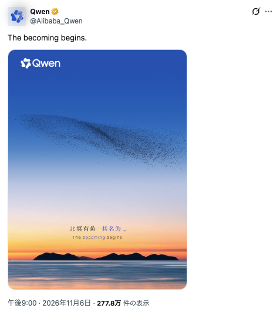
  

Sources: <a href="https://x.com/Alibaba_Qwen/status/2118674834632978755">Qwen公式投稿</a> · <a href="https://geroundtable.com/qwen4-teaser-becoming-begins/">反響の報道</a>

---

## Qwenの自己改善 RSI

  <a class="news-clip news-clip--cloud" href="https://www.alibabacloud.com/blog/alibaba-unveils-roadmap-on-full-stack-ai-strategy-from-chips-cloud-infrastructure-models-to-agents_603589">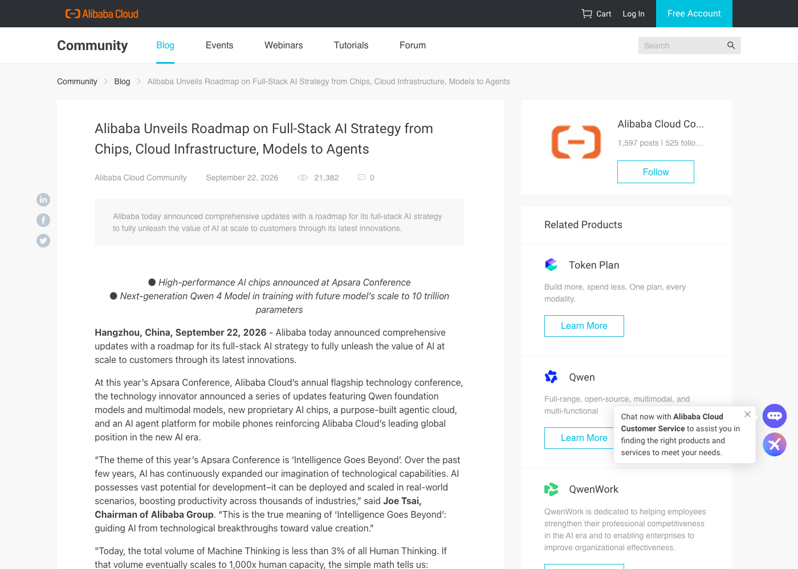</a>
  <a class="news-clip news-clip--keynote" href="https://home.alibabagroup.com/en-US/document-2039431633571938304">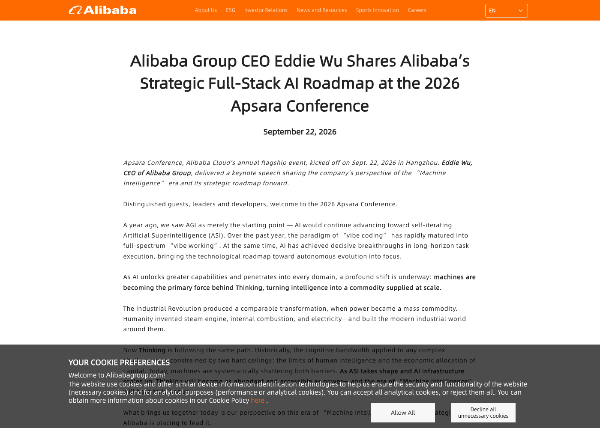</a>
  <a class="news-clip news-clip--frontier" href="https://www.thefrontier.dev/articles/alibaba-qwen3-8-max-self-improvement-claim">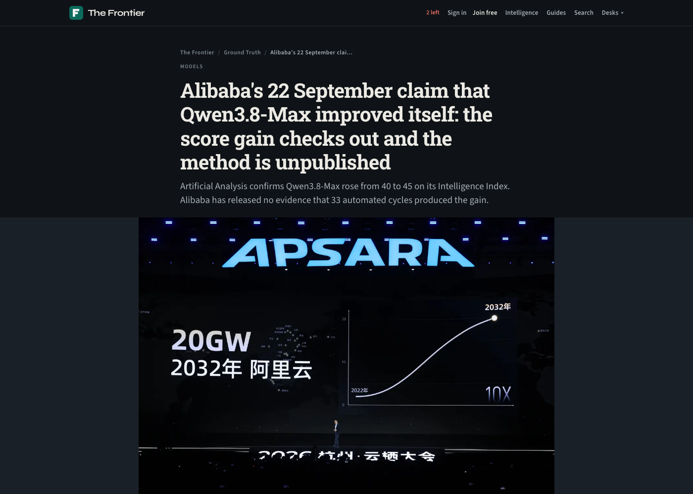</a>

Sources: <a href="https://www.alibabacloud.com/blog/alibaba-unveils-roadmap-on-full-stack-ai-strategy-from-chips-cloud-infrastructure-models-to-agents_603589">Alibaba Cloud</a> · <a href="https://home.alibabagroup.com/en-US/document-2039431633571938304">Alibaba Group</a> · <a href="https://www.thefrontier.dev/articles/alibaba-qwen3-8-max-self-improvement-claim">The Frontier</a>

---

## AIの自己改善ループ

自分の経験を使って学習し、更新後のモデルで再び挑戦する

  
<b>1. 問題を解く</b>モデルが候補回答を生成

  
→

  
<b>2. 結果を検証</b>正しい回答を選ぶ

  
→

  
<b>3. 重みを更新</b>得られた経験で学習

  
→

  
<b>4. 再び挑戦</b>更新後のモデルを評価

研究によっては、この一連の流れを繰り返す。

今回試したのは、<strong>検証済み回答を使った1回のLoRA更新</strong>と、更新前後の比較。

重み更新を伴う自己改善の概略。Alibabaが発表した33サイクルの詳細を示すものではない。 · <a href="https://arxiv.org/abs/2203.14465">STaR</a> · <a href="https://arxiv.org/abs/2507.14172">SOAR</a>

<!-- ---

## 自分の経験から、モデルの重みを更新する

  

    
正解した推論から学ぶ
<h3>STaR <small>2022</small></h3>
    
回答と推論を生成し、正解につながった推論で再学習する。

    
今回との接点：検証済みの回答で学ぶ

  

  

    
ARCの解法を探索して学ぶ
<h3>SOAR <small>2025</small></h3>
    
解法プログラムを探索し、その経験でモデルを再学習する。

    
今回との接点：ARCで学習と評価を行う

  

  

    
問題そのものも自ら作る
<h3>Absolute Zero <small>2025</small></h3>
    
問題を生成・検証し、解いた結果を報酬として強化学習する。

    
今回との違い：既存のARC問題を使用

  

今回は<strong>Qwenの回答を検証し、LoRAで重みを更新</strong>。過去の別モデル実験由来の回答も学習に含む。

Papers: <a href="https://arxiv.org/abs/2203.14465">STaR</a> · <a href="https://arxiv.org/abs/2507.14172">SOAR</a> · <a href="https://arxiv.org/abs/2505.03335">Absolute Zero</a> ｜ 各研究の学習手法・評価条件は異なる。
 -->

---

## 今回解いてみたい実験

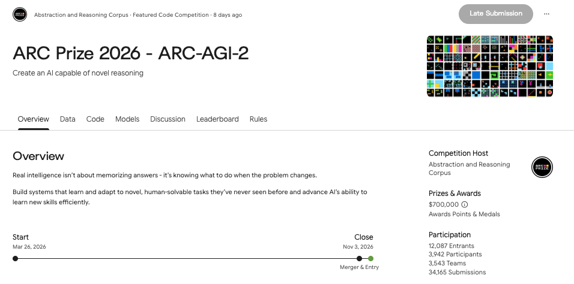

---

## ARC-AGI-2：例から規則を見つける

  

    <h3>例を見て、未知の入力を変換する</h3>
    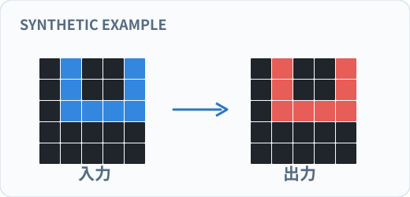
    
上は説明用の合成例。色付きのマス目に潜む規則を推測する。

  

  

    

      
<b>1,000</b><small>公開Training</small>

      
<b>120</b><small>公開Evaluation</small>

    

    
入力・出力の数例から、別の入力に対する正確な出力グリッドを予測。

    
2025年ARC Prize優勝はPrivate Evalで24.03%。このスコアと今回のTraining問題での結果は<strong>直接比較できない</strong>。

  

Sources: <a href="https://arcprize.org/blog/announcing-arc-agi-2-and-arc-prize-2025">ARC-AGI-2 design</a> · <a href="https://arcprize.org/blog/arc-prize-2025-results-analysis">ARC Prize 2025 Results</a>

---

## 実際のARC-AGI-2を見てみよう

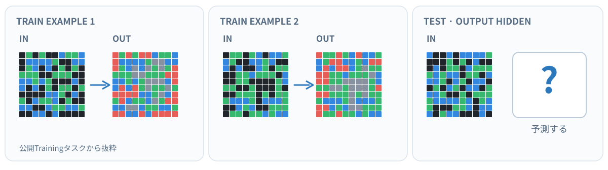

左の例からルールを考え、右の<strong>テスト入力</strong>をどう変換するか？

公開Training問題84db8fc4の4例中2例を抜粋。テストの正解出力は表示していない。

Source: <a href="https://github.com/arcprize/ARC-AGI-2/blob/main/data/training/84db8fc4.json">ARC-AGI-2 · training/84db8fc4.json</a> (train input/output and test input only)

---

## 今回の方法：生成・検証・LoRA・比較

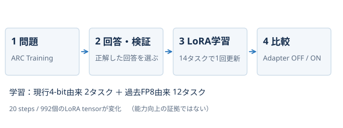

---

## Qwen 3.8単体でどのくらい解けたか？

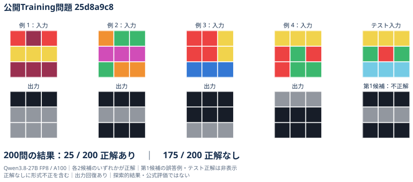

---

## 正解数：更新前と更新後の比較

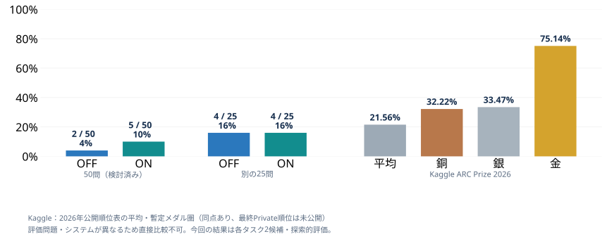

---

## 出力形式：読み取り可能な候補の割合

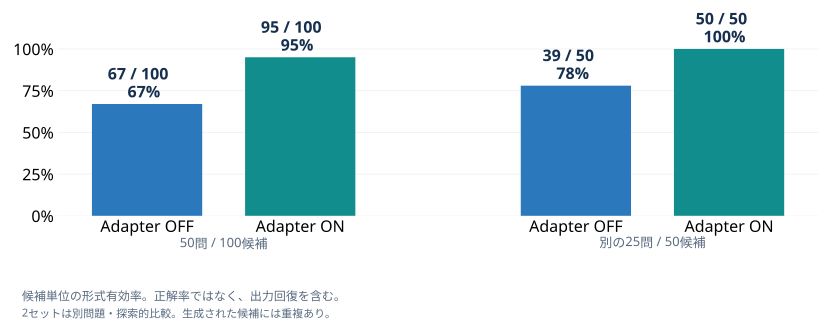

---

## EOP
