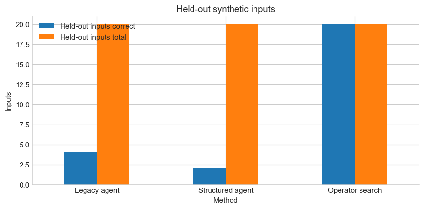
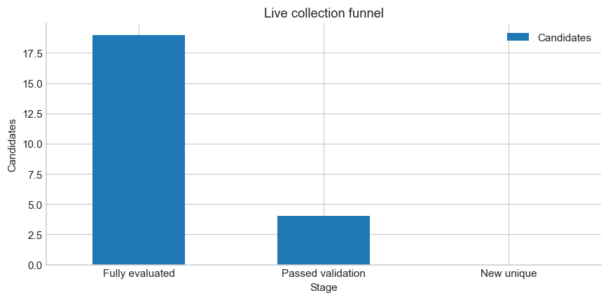
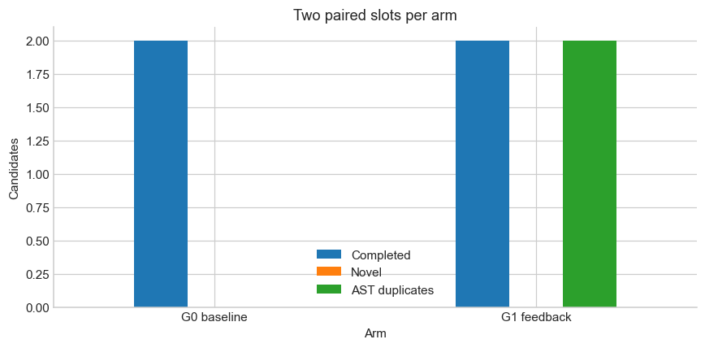
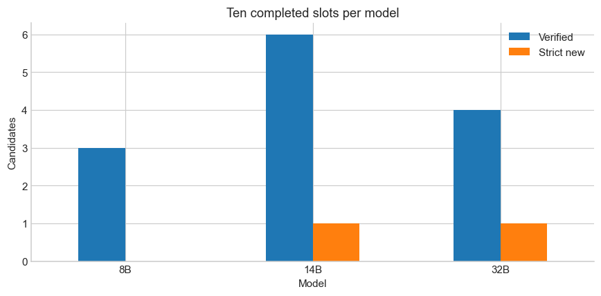
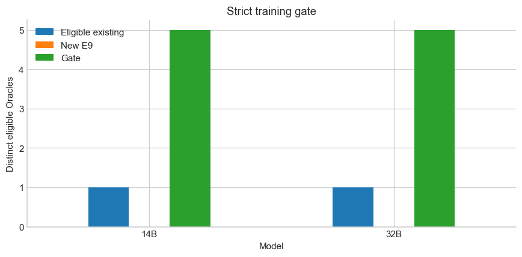

<!-- _paginate: false -->
<!-- _class: slide--title -->

  
QWEN MEETUP TOKYO · LOCAL LLM EXPERIMENTS

  <h1>Can Qwen Improve Itself on ARC?</h1>
  

  
自己生成データから、問題を解く力は伸ばせるのか？

  
Qwen3 · ARC-AGI-2 · Apple Silicon · experiments through 2026-11-05

---

## 今回の問い

  
<h3>1 · Solve</h3>
例からルールを推測し、未知のグリッドを解けるか？

  
<h3>2 · Generate</h3>
学習に使える問題とプログラムを自分で作れるか？

  
<h3>3 · Improve</h3>
そのデータで学習し、独立した問題で改善するか？

結果：学習の仕組みは動いた。ARCの正答率向上はまだ示せていない。

Overview: ../nb/00_overview.ipynb

---

## ARCは「例からルールを見つける」課題

  
<h3>入力</h3>
色付きグリッドの入力と出力の例を複数見る。

新しい入力に同じ変換を適用する。

  
<h3>今回の方法</h3>
Qwenに変換用Pythonを書かせる。

隔離環境で実行し、独立した出力で検証する。

動くコードと、正しい変換は違う。

../docs/p3c-live-audit.md · Evaluation labels are kept out of prompts

---

## まずは実問題を解いて、学習データを集める

  

1 / 260<small> independently verified solutions 4B: 0/220 · 8B: 1/40</small>

  
通常の学習ゲートは、検証済み5件。

  
<h3>1件の別パイロット</h3><ul><li>8Bで実際にQLoRAを実行</li><li>ベース重みを維持しadapterを保存</li><li>比較時に4/5タスクでエラー → rollback</li></ul>

../docs/p3b-local.md · 1-example pilot was separate from the normal five-record gate

---

## 探索方法を変えても、正解は増えなかった

  
<h3>E2 · 4つの戦略</h3>
同じ5問で比較。

0 / 5<small> 各戦略のheld-out正解</small>

  
<h3>E3 · 追加収集</h3>
選択した方法で19問に着手。

0<small> 独立検証を通った解答</small>

E2の選択は同点時のfallback。優れた方法を見つけた証拠ではない。

../docs/e4-analysis.md · ../artifacts/e2-live-full-reselected/report.md

---

## 単純な変換なら、人間が設計した探索は強い

  

  

20 / 20<small> operator search · 合成held-out入力</small>

モデルのコード生成は4/20。

問題は探索対象の変換族から作成。一般的なARC性能は示さない。

../docs/e4-analysis.md · 10 synthetic tasks, two held-out inputs each

---

## E5：自分で作った問題を、自分で解けるか

  
<h3>Generator</h3>
Qwenが変換プログラムを生成。

一般的な実行エラーのフィードバックで修正し、1問を作成。

  
<h3>Solver</h3>
生成コードを見ずに例から解く。

0 / 2<small> 独立検証に通った候補</small>

問題を作ることと、独立して解くことは別。

../docs/e5-autonomous-rsi.md · live Qwen3-8B smoke

---

## E6：生成プログラムを教師にすると？

  

2 / 5<small> distinct verified task / Oracle shapes E6 bootstrap</small>

5件に届かず、QLoRAはスキップ。

  
<h3>Generator distillation</h3>
生成したプログラムを教師として使う。

これは自己解答に成功した例ではない。

../docs/e6-self-generated-curriculum.md · Historical records later lacked a pinned static-checker dependency

---

## E6-F：修正しても、新しいOracleは増えない

  

  

<strong>4件</strong>が検証を通過。

ただし4件とも既存プログラムと重複。

新規は 0 件

../docs/e6f-oracle-reliability.md · 19 fully evaluated; one additional candidate was budget interrupted

---

## E6-G / E7：重複を伝えると改善する？

  

  

同じ条件で、重複についての通知だけを変えた。

0 vs 0<small> E7 · new Oracles, two slots per arm</small>

改善は観察されず。小標本では効果の有無を断定できない。

../docs/e6g-autonomous-curriculum-diversity.md · ../docs/e7-autonomous-rsi-feasibility.md

---

## E8：モデルを大きくすると？

  

  

各モデル10 slot、同じ検証条件。

0 · 1 · 1<small> strict new Oracles 8B · 14B · 32B</small>

全モデルが5件未満。

../docs/e8-full-rerun-20261104.md · corrected preregistered rerun; small sample

---

## E9：14Bと32Bを分けて収集

  

  

各モデルが使える既存Oracleは1件。

監査済み追加収集の新規は<strong>両モデルとも0件</strong>。

1/5：学習も、adapter比較も未実施。

../docs/e9-dual-model-rsi.md · 14B extra: 30 slots; 32B initial: 10 slots

---

## 「検証済み」を分解する

  
<h3>実行可能</h3>
安全に動き、出力形式を満たす。

  
<h3>Oracle検証</h3>
非公開probeなどの条件を通る。

  
<h3>Strict new</h3>
重複と出自の条件も満たす。

旧E8 Fullは実行依存コードのhashが欠落。修正版の別runで再比較した。

../docs/e8-full-rerun-20261104.md · ../docs/e9-dual-model-rsi.md

---

<!-- _class: slide--closing -->

  
TAKEAWAY

  <h1>Training ≠ Improvement</h1>
  

  
学習できたことと、未知の問題で改善したことを分けて測る。

  

    
<h3>1 · Data</h3>
独立検証と多様性がボトルネック

    
<h3>2 · Provenance</h3>
依存コードも含めて事前固定

    
<h3>3 · Evaluation</h3>
同条件の比較で転移を測る

  

  
Explore the evidence: ../nb/README.md

